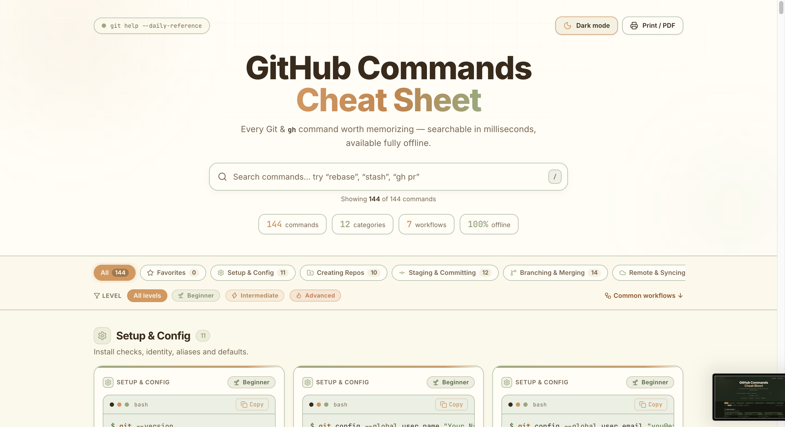
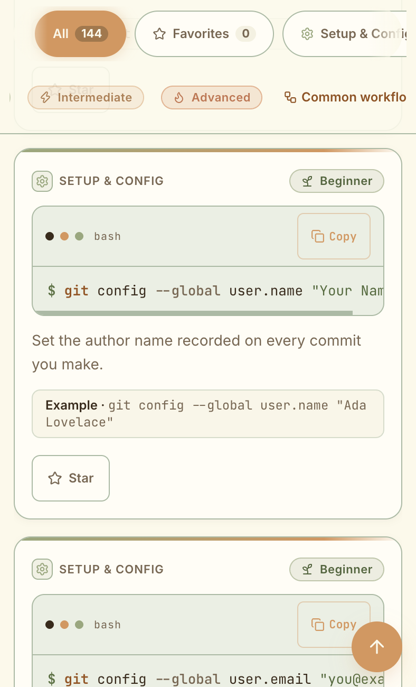

# GitHub Commands Cheat Sheet

A fast, beautiful, searchable cheat sheet of Git and GitHub commands for daily reference.
Works **fully offline** as a static site — no backend, no tracking.

## Screenshots

## Screenshots

### Screenshot 1


### Screenshot 2


### Screenshot 3


## Features

- **140+ commands** across 12 categories (Setup, Creating, Staging, Branching, Remote, Undoing, Stash, Tags, Rebase, Inspecting, GitHub CLI, Collaboration)
- **Instant search** across command, description, example, category, and keywords, with match highlighting (debounced)
- **Copy button** on every command with “Copied!” confirmation + clipboard fallback
- **Command cards**: monospace command, one-line description, realistic example, ⚠ careful notes on destructive commands
- **Difficulty tags** (Beginner / Intermediate / Advanced) with filter
- **Favorites** (☆/★) persisted in `localStorage`, with a dedicated view + empty state
- **Dark/light mode** toggle respecting system preference (persisted, follows OS until you choose)
- **Common workflows**: 7 step-by-step recipes (undo commit, fix message, sync fork, merge conflicts, squash PR, recover lost commit, feature → PR)
- **Print-friendly** stylesheet + “Print / PDF” button (browser print → Save as PDF)
- **Keyboard shortcuts**: `/` focuses search, `Esc` clears it
- Responsive + accessible: semantic landmarks, skip link, ARIA labels/pressed/live regions, visible focus rings

## Setup

```bash
npm install
npm run dev      # local dev server (default http://localhost:5173)
npm run build    # typecheck (tsc -b) + production build into dist/
npm run preview  # serve the production build locally
npm run lint     # oxlint
```

Requires Node 20+.

## Deploy to GitHub Pages

1. Push to the `main` branch — `.github/workflows/deploy.yml` builds and deploys `dist/` automatically.
2. In the repo: **Settings → Pages → Source: GitHub Actions**.
3. `vite.config.ts` uses `base: './'` so assets resolve on project sites (`user.github.io/repo/`) and offline `file://` alike. If you prefer absolute URLs, set `base: '/<repo-name>/'`.

## How to add a new command

All content lives in typed data — no CMS, no backend.

1. Open `src/data/commands.ts`.
2. Append to `COMMANDS`:
   ```ts
   {
     id: "remote-unique-id",          // kebab-case, unique
     command: "git push --tags",      // exact, verified syntax
     description: "One-line what/why.", // one line, plain words
     example: "git push --tags",      // short realistic usage
     category: "remote",              // one of CategoryId (see CATEGORIES)
     difficulty: "Intermediate",      // Beginner | Intermediate | Advanced
     keywords: ["push", "tags"],      // search helpers
     // careful: "Why this is risky.", // only for destructive commands
   },
   ```
3. To add a recipe, append to `WORKFLOWS` in `src/data/workflows.ts` with ordered `steps` (`title`, optional `command`, `explanation`).
4. Verify: `npm run build` must pass with zero type errors. Double-check every flag against `git help <cmd>` / `gh help` — never invent flags.

## Contribution guide

- Use **conventional commits**: `feat:`, `fix:`, `docs:`, `refactor:`, `style:`, `chore:`.
- One logical change per commit; keep PRs small and focused.
- TypeScript: strict, no `any`. Run `npm run build` + `npm run lint` before pushing.
- Accessibility: keep semantic HTML, labels, focus states, and contrast when touching UI.
- Content PRs: cite the doc/flag source for new commands; destructive commands **must** include a `careful` note.

## Project structure

```
src/
  data/
    commands.ts      # Category + GitCommand types, CATEGORIES, COMMANDS (140+)
    workflows.ts     # Workflow recipes
  components/
    SearchBar.tsx CategoryNav.tsx CommandCard.tsx WorkflowCard.tsx
    ThemeToggle.tsx FavoritesView.tsx Highlight.tsx DifficultyBadge.tsx
  hooks/
    useLocalStorage.ts useDebounce.ts useTheme.ts
  App.tsx            # shell: search/filter/favorites/shortcuts/print
  main.tsx index.css
.github/workflows/deploy.yml  # Pages deploy
vite.config.ts                # base './' for Pages + offline
```
